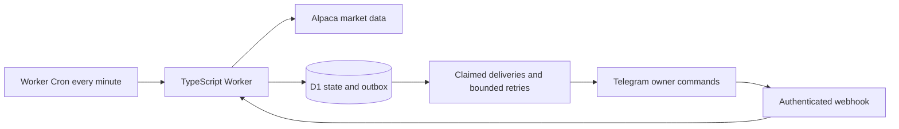

# Stock Alert Bot

Personal US stock alerts in English through Telegram, with automatic daily support/resistance and manual overrides. Runs on Cloudflare Workers + D1 with Alpaca historical SIP bars and live IEX trades. No AI, dashboard, or order execution.

**Default: dry run.** Commands and operational notices are delivered; price alerts are written to the outbox and logged instead of sent. The repository contains no account credentials or deployment. Free operation is a target, not a verified production result: check your Alpaca permissions and deployed CPU/database usage before enabling live alerts.

## Architecture and design



The project focuses on reliable monitoring: D1 transactions keep state changes and outgoing events together, revision checks protect concurrent updates, and webhook update IDs prevent repeated command processing. Delivery claims and retries handle temporary failures, with the remaining duplicate-delivery limitation documented below.

Automatic zones use a deterministic, versioned pivot algorithm. Daily Wilder RSI is calculated from the same completed historical bars. These calculations have not been backtested for profitability. This is a personal monitoring tool with no order execution.

GitHub Actions runs formatting, type checking, tests, and a dry-run build. The workflow has read-only repository permissions and does not deploy or require provider secrets.

## Requirements and local checks

- Node.js 22.12 or later, npm.
- A Cloudflare **Free** account, an Alpaca paper account with market-data credentials, and your own Telegram bot from BotFather.
- A Telegram user ID and private chat ID for the sole owner. Start a private conversation with the bot. Do not put keys or bot tokens in chat, source files, or shell command arguments.

```powershell
npm ci
npm run typecheck
npm test
npm run build
npm run db:local
Copy-Item .dev.vars.example .dev.vars
# Edit .dev.vars locally with your credentials and numeric Telegram IDs.
npm run dev
```

`npm test` uses a real local D1 database through Miniflare plus mocked upstream providers. Windows sandbox restrictions may prevent workerd/SQLite from starting; run tests in a normal local terminal if access is denied. `npm run build` only bundles and never deploys.

With the local server running, `GET /health` exposes only configuration presence (not provider health). `GET /__scheduled` on Wrangler's test-scheduled server invokes the scheduled handler. With real credentials, local runs can send command replies and operational notices to your configured chat even when dry-run is enabled; automated tests use fake credentials and mocks.

## Cloudflare and Telegram setup

The checked-in `wrangler.jsonc` is a safe template. For an existing installation, keep the account-specific configuration in ignored `wrangler.local.jsonc` and pass `--config wrangler.local.jsonc` to Wrangler. For example, use `npm run deploy -- --config wrangler.local.jsonc` and `npm run db:remote -- --config wrangler.local.jsonc`. Secret updates must target the same configuration: `npx wrangler secret put NAME --config wrangler.local.jsonc`. Keep `.dev.vars` and local configuration files out of Git. The setup steps below describe a new installation using the template.

1. Authenticate locally with `npx wrangler login` and create the database with `npx wrangler d1 create stock-alert-bot`. Put its returned ID into `wrangler.jsonc`, replacing the all-zero placeholder.
2. Apply the schema with `npm run db:remote`.
3. For each name below, run `npx wrangler secret put NAME` and paste its value at the secure prompt:
   `ALPACA_KEY`, `ALPACA_SECRET`, `TELEGRAM_TOKEN`, `TELEGRAM_WEBHOOK_SECRET`, `OWNER_USER_ID`, `OWNER_CHAT_ID`.
   Generate a long random webhook secret using letters, digits, `_` or `-`. Owner IDs must be the actual numeric IDs, not a username.
4. Leave `DRY_RUN` as `"true"`, then run `npm run deploy`. This creates the one-minute Cloudflare Cron and HTTPS Worker.
5. Register the webhook from your local secret file:

```powershell
node --env-file=.dev.vars scripts/register-webhook.mjs https://YOUR-WORKER.workers.dev
```

6. In the private Telegram conversation, send `/help`, `/status`, and `/add AAPL`. The empty initial watchlist supports up to 20 active listed US stocks/ETFs. Use your preferred symbols.
7. Verify historical SIP access and IEX trade access. HTTP 401/403 errors require fixing account credentials/permissions; the bot does not silently switch feeds or subscribe to a paid plan.
8. Observe at least two full sessions with a 20-symbol watchlist. Inspect level evidence, dry-run alert logs, CPU time, D1 row metrics, and recovery behaviour. After validation, change `DRY_RUN` to `"false"` and redeploy. Old dry-run events are not replayed.

If Wrangler cannot write its default Windows config/log folder, set `XDG_CONFIG_HOME` to a writable local directory for build-only checks. Use a consistent config location for authenticated deployment commands.

## Telegram commands

| Command                                                   | Purpose                                                              |
| --------------------------------------------------------- | -------------------------------------------------------------------- |
| `/add AAPL`                                               | Validate and watch a symbol; queue automatic levels                  |
| `/remove AAPL`                                            | Remove monitoring and cancel pending price messages                  |
| `/list`                                                   | Show watchlist, mode, and pause state                                |
| `/levels AAPL`                                            | Show zones, source/session dates, and pivot evidence                 |
| `/rsi AAPL`                                               | Show the last calculated daily Wilder RSI(14) and its session date   |
| `/setlevels AAPL support=99-101,94-96 resistance=110-112` | Replace all automatic zones with manual zones                        |
| `/auto AAPL`                                              | Clear manual zones, resume automatic mode, queue refresh             |
| `/pause AAPL` / `/resume AAPL`                            | Pause/resume a symbol                                                |
| `/pause all` / `/resume all`                              | Global pause; global resume retains individual pauses                |
| `/status`                                                 | Show mode, market state, last checks, failures, and delivery backlog |
| `/help`                                                   | Show usage and limitations                                           |

Manual zones require positive `low-high` boundaries, no overlaps, and at most two per side. Use `none` for an empty side, but not both. Manual prices do not adjust automatically for stock splits; the owner must update them.

## Daily RSI

Daily calculation results are sent as one watchlist summary per completed market session, after every current symbol has either updated or attempted its update. Each row shows zone count (or manual mode) and RSI; failed symbols are listed with a retry notice instead of blocking the summary. The report marker is persisted atomically with the outbox message. Retries, newly added stocks, and `/auto` refreshes after that summary update stored results silently; use `/levels` or `/rsi` to inspect them. Price alerts and provider-outage notices remain separate. Calculations still run one stock per minute starting at 07:00 New York (18:00 Bangkok during US daylight saving, 19:00 otherwise), so the summary arrives after the watchlist finishes, not exactly at 18:00. Unchanged historical sessions on holidays/weekends do not produce duplicate summaries.

`/list`, `/levels SYMBOL`, `/rsi SYMBOL`, and daily calculation notices show RSI(14, daily, Wilder). It uses completed, split-adjusted SIP closes from the same historical request as automatic levels, with up to 120 bars. The first 14 price changes seed average gain/loss; subsequent changes use Wilder smoothing. All-flat history is explicitly reported as 50, gains without losses as 100, and losses without gains as 0. Different feeds, history lengths, adjustments, and unfinished candles can produce different values from charting platforms.

RSI refreshes for both automatic and manual stocks, one symbol per scheduler invocation starting at 07:00 New York time. Existing stocks without RSI are backfilled automatically. Manual zones and their alert baselines are preserved during RSI refresh. Before calculation the value is shown as pending; on failure the previous value keeps its original date and is marked with a refresh error, with a six-hour retry. This is a dated daily reading, not live intraday RSI, and does not trigger RSI buy/sell alerts. No database migration or new provider credentials are required.

## How automatic levels work

- Before the session, starting at 07:00 New York time, refresh one symbol per Cron invocation. New or explicitly refreshed symbols use the same queue (not before 07:00). A failed symbol waits six hours before retrying so it cannot block other symbols.
- Retrieve up to 120 completed, split-adjusted daily SIP bars, with at least 60 required. Explicitly use a historical end time at midnight UTC before the current US session, outside the recent-15-minute SIP restriction. Verify the most recent completed session exists.
- A low/high pivot must be strictly lower/higher than two bars on both sides. The newest two bars cannot be confirmed pivots. Equal neighbouring extremes do not qualify.
- Cluster lows and highs separately, sorting by price. Total cluster span cannot exceed 0.5% of its minimum. Require two distinct pivot dates. Use the cluster min/max as boundaries, widened to 0.2% of midpoint when needed.
- Keep the nearest two support zones wholly below the latest close and nearest two resistance zones wholly above it. No invented fallback zones. The algorithm is versioned as `daily-pivots-v1`.
- Activate each symbol's new zones atomically and reset its baseline. Failed automatic levels can remain usable for one trading-session lag; older levels suppress automatic alerts. Manual mode bypasses automatic refresh.

The provider's daily bars are used as delivered; they are not reconstructed from regular-session-only minute candles. Zone parameters are initial heuristics, not backtested indicators of profitability.

## Monitoring and delivery semantics

- Poll the market clock/calendar each minute and fetch all active symbols' latest IEX trades in one request only during a verified regular session. Calendar/clock checks handle holidays, early closes, and DST. Timestamp displays use Bangkok time.
- Ignore trades older than 120 seconds, invalid prices, duplicate/out-of-order timestamps, and future timestamps beyond five seconds. Baseline after session changes, startup without stored state, resume, level changes, and gaps exceeding two minutes. This intentionally does not infer opening-gap crossings.
- Emit zone entry or a breakout/breakdown beyond the outer boundary; a jump over a whole zone emits only the break event. Each zone/event has a 30-minute cooldown and requires a 0.2% return beyond the boundary to re-arm. Support/resistance roles do not flip within a level set.
- Aggregate simultaneous events per symbol. Outbox items are capped at 3,500 characters; five deliveries are attempted per invocation. Telegram rate limits and transient failures get bounded retries, respecting `retry_after`. Price messages expire after ten minutes; command/system messages after one day. Ten failed attempts or permanent Telegram errors stop retries.
- State and outbox events commit in one D1 transaction with optimistic revision checks. A conflicting scan is discarded and retried on the next minute. Webhook update IDs are deduplicated; deliveries use exclusive claims. Remove/pause/level changes invalidate pending price alerts, but cannot recall an already in-flight send.
- Telegram does not offer a send-message idempotency key: a timeout after acceptance can cause a duplicate. Exactly-once message delivery is **not** promised.
- A 15-minute data outage emits one incident notice and one recovery notice. Session-check outages also generate an incident because the bot cannot verify whether it should be monitoring. Daily bounded cleanup retains approximately seven days of operational records; a large backlog may take additional days to remove.

## Operations and acceptance

Inspect Cloudflare logs for `scan_complete`, `scan_conflict_skipped`, `scan_failed`, `scan_deadline_exceeded`, `telegram_permanent_failure`, and `dry_run_alert`. `/status` provides last successful checks and queue depth. A scheduler that stops completely cannot report its own outage; inspect Worker metrics if status timestamps stop advancing.

Workers Free allows 10 ms CPU per invocation. Network waits do not count as CPU. D1 Free permits 100,000 written rows/day and 5 million read rows/day, shared with other account usage. The design stores the watchlist/state as one revisioned JSON row and bounds refresh/delivery work; it still needs deployed measurement. Target under 50,000 written rows/day including indexes/housekeeping, and no CPU-limit failures. Do not switch to paid plans automatically.

Before live activation, confirm: correct owner authentication; all 20 symbols refresh; holidays/early close gating; no stale-price alerts; pause and manual override behaviour; Telegram recovery; no ordinary retry duplicates; and measured free-tier headroom. Local test success does not verify production account access or runtime quotas.

References: [Alpaca market data](https://docs.alpaca.markets/us/docs/market-data-faq), [Workers limits](https://developers.cloudflare.com/workers/platform/limits/), [D1 pricing](https://developers.cloudflare.com/d1/platform/pricing/), [Telegram Bot API](https://core.telegram.org/bots/api).
